<div align="center">

# 🔑 Gestionnaire de Clés

**Prêts, retours, inventaire et documents du parc de clés d'un établissement scolaire — dans une seule application Windows, sans installation.**


[Télécharger](https://github.com/collet-david-pro/Clefs/releases) ·
[Prise en main](#-prise-en-main-en-7-étapes) ·
[Fonctionnalités](#-fonctionnalités) ·
[Questions fréquentes](#-questions-fréquentes) ·
[Développeurs](#-pour-les-développeurs)

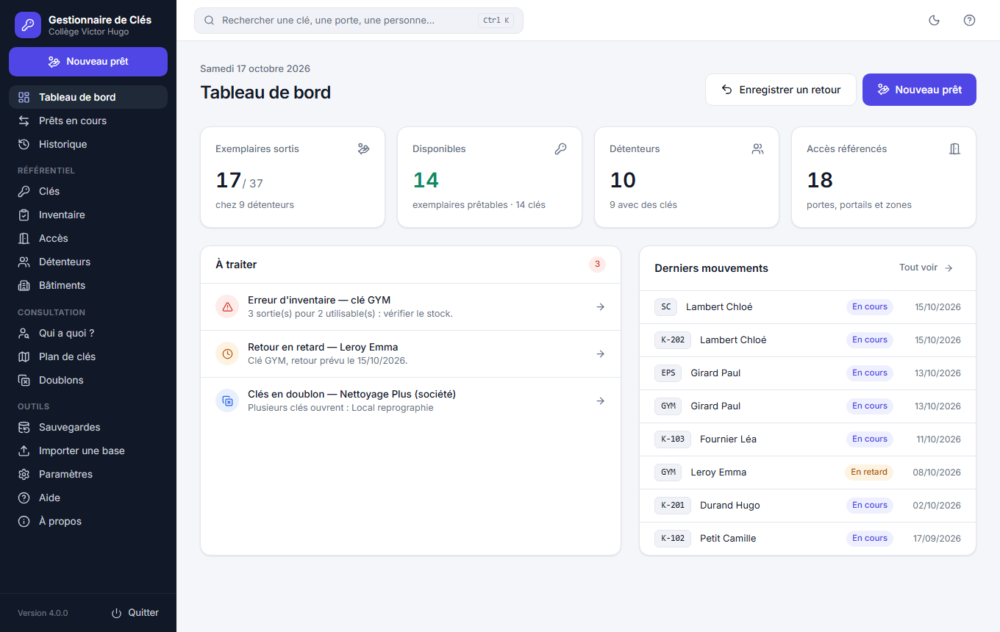

</div>

---

## ✨ En bref

- **Prêt par besoin** — on coche les portes à ouvrir, l'application propose le plus petit trousseau qui les ouvre.
- **Bon de remise PDF** à chaque prêt, sur une page A4, prêt à signer ; tous les bons en un seul PDF pour l'archivage.
- **Inventaire rapide** — on compte les clés présentes, le stock se met à jour tout seul (clés retrouvées, cassées, perdues).
- **Tout se retrouve en deux clics** — recherche globale, fiche de chaque clé, porte et personne, historique complet.
- **Personnalisable** — nom de l'établissement, logo, textes des bons, valeurs par défaut.
- **Simple à déployer** — un seul fichier `.exe`, aucune installation, utilisable à plusieurs sur un partage réseau.
- **Reprend vos anciennes données** — les bases des versions 1, 2 et 3 s'importent sans perte.

---

## 🚀 Prise en main en 7 étapes

### 1. Installer

1. Téléchargez `clefs-windows-amd64.zip` depuis la page [**Releases**](https://github.com/collet-david-pro/Clefs/releases).
2. Décompressez-le dans un **dossier dédié** (par exemple `C:\Clefs-V4\` ou un dossier du partage réseau).
3. Double-cliquez sur `clefs-windows-amd64.exe`.

> Windows peut afficher une alerte car l'exécutable n'est pas signé : **« Informations complémentaires » → « Exécuter quand même »**.
> Rien d'autre à installer : l'affichage utilise Microsoft Edge WebView2, fourni avec Windows 10 et 11.

L'application range tout à côté d'elle :

```
MonDossierClefs/
├── clefs-windows-amd64.exe
├── clefs.db        ← la base de données (à ne pas supprimer)
├── backups/        ← les sauvegardes
└── documents/      ← les PDF et exports Excel
```

### 2. Reprendre vos données

Au premier lancement, l'**assistant d'import** s'ouvre. Choisissez le `clefs.db` de votre ancienne version (1, 2 ou 3) : la version est reconnue et un aperçu s'affiche avant d'importer. L'ancien fichier n'est jamais modifié.

Pas d'ancienne base ? Commencez à zéro ou chargez les données de démonstration.

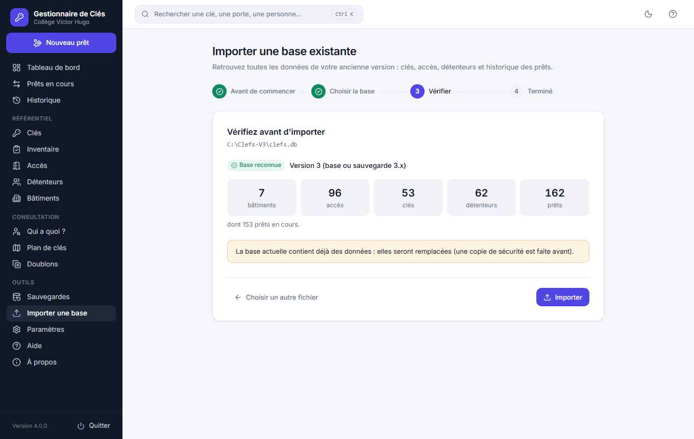

### 3. Personnaliser

**Paramètres → Établissement et documents** : nom et adresse de l'établissement, logo, titre et texte d'engagement des bons de remise, signataire, type de prêt et durée de retour proposés par défaut. Le bouton **« Aperçu d'un bon »** montre le résultat avant d'enregistrer.

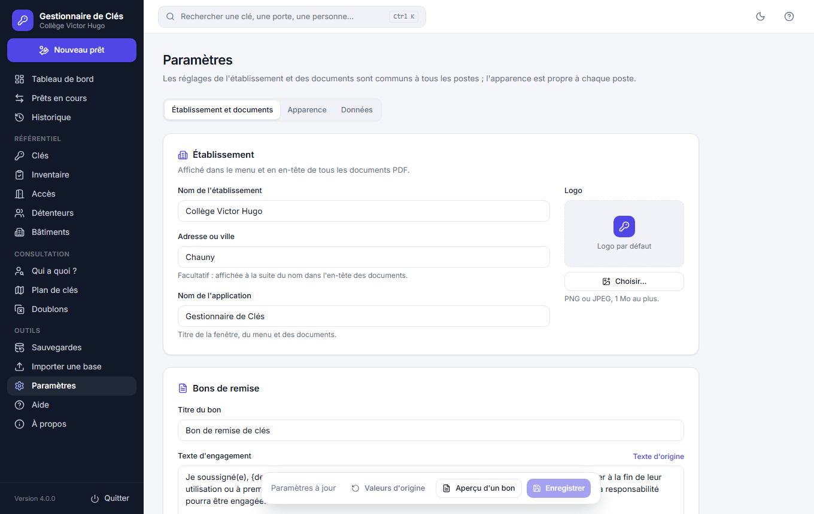

### 4. Prêter des clés

**Nouveau prêt** (ou `Ctrl + N`) : choisissez la personne, cochez les portes qu'elle doit ouvrir… le trousseau se compose tout seul. Retirez ou ajoutez une clé si besoin, indiquez la date de retour, validez : le bon de remise est prêt à imprimer.

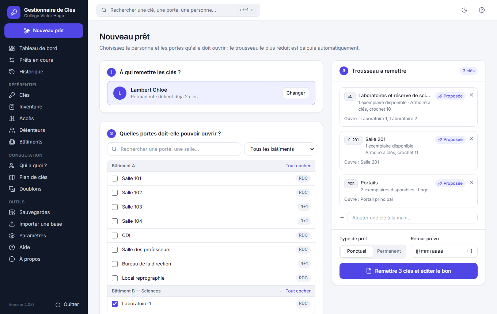

<p align="center">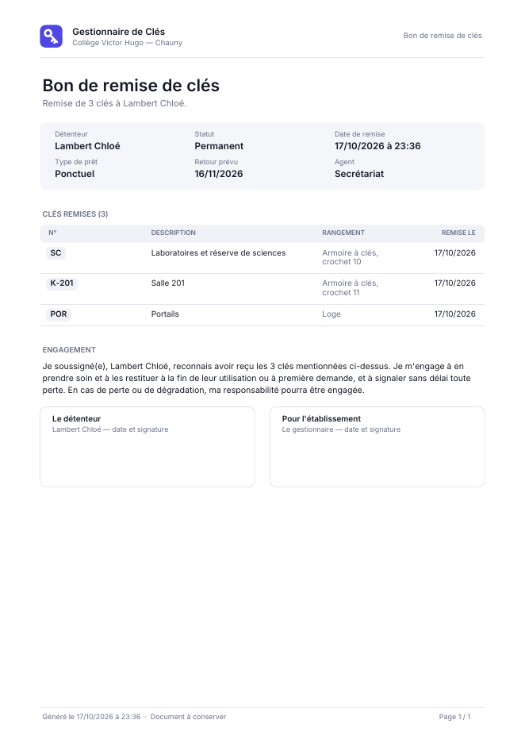</p>

### 5. Suivre et enregistrer les retours

Un clic sur une personne, une clé ou une porte ouvre sa **fiche** : ce qu'elle détient, ce qu'elle ouvre, son historique, et les actions utiles (retour, nouveau prêt, réédition du bon). Le **tableau de bord** signale les retards, les erreurs de stock et les clés en doublon.

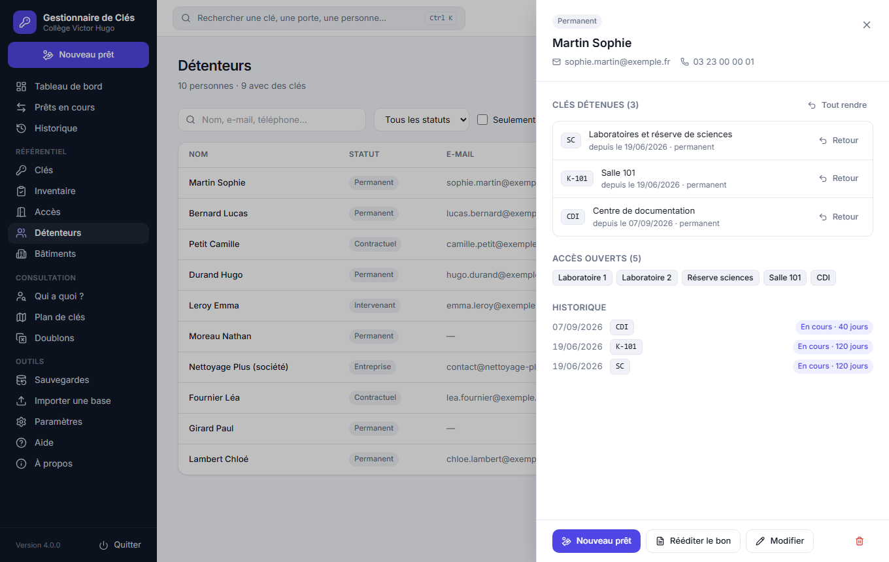

### 6. Faire l'inventaire

**Inventaire** : comptez les exemplaires présents dans l'armoire. Le nouveau total (comptés + prêtés) et les écarts s'affichent en direct ; à la validation, un **rapport d'inventaire PDF** liste les écarts.

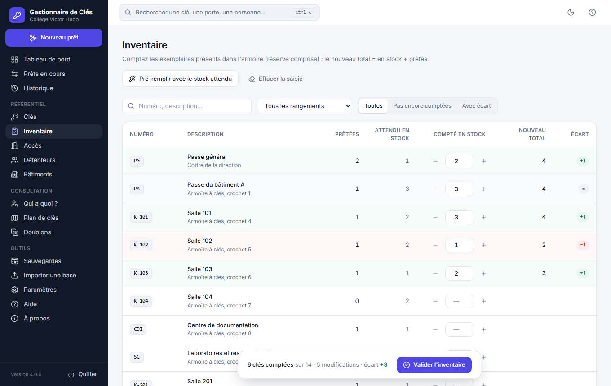

### 7. Sauvegarder

**Sauvegardes → « Sauvegarder maintenant »** : une copie complète de la base dans `backups/`. À faire régulièrement, et toujours avant une mise à jour. La restauration fait elle-même une copie de sécurité avant de remplacer les données.

---

## 🧭 Fonctionnalités

| | |
|---|---|
| **Prêts** | Prêt par besoin avec trousseau minimal calculé, ajout ou retrait manuel, type ponctuel / permanent, date de retour prévue, agent enregistré |
| **Retours** | Unitaires ou groupés, état constaté conservé dans l'historique |
| **Stock** | Disponibilité calculée (total − réserve − sorties), alerte « erreur d'inventaire » si plus de clés sont sorties que le stock (signalé, jamais bloqué), inventaire rapide |
| **Référentiel** | Bâtiments, accès (portes, portails, zones), clés et portes qu'elles ouvrent, détenteurs (import d'une liste Excel) |
| **Consultation** | Tableau de bord, recherche globale (`Ctrl + K`), fiches détaillées, Qui a quoi ?, Plan de clés, Doublons, Historique filtrable |
| **Documents PDF** | Bon de remise (une page A4), archive de tous les bons, bilan du stock, plan de clés, rapport d'inventaire |
| **Exports Excel** | Clés, détenteurs, prêts en cours, historique (CSV ouvrable directement dans Excel) |
| **Données** | Import V1 / V2 / V3, sauvegardes et restauration, plusieurs postes sur un partage réseau |
| **Confort** | Mode clair / sombre, raccourcis clavier, aide intégrée pas à pas, confirmations avant les actions sensibles |

<table>
  <tr>
    <td align="center">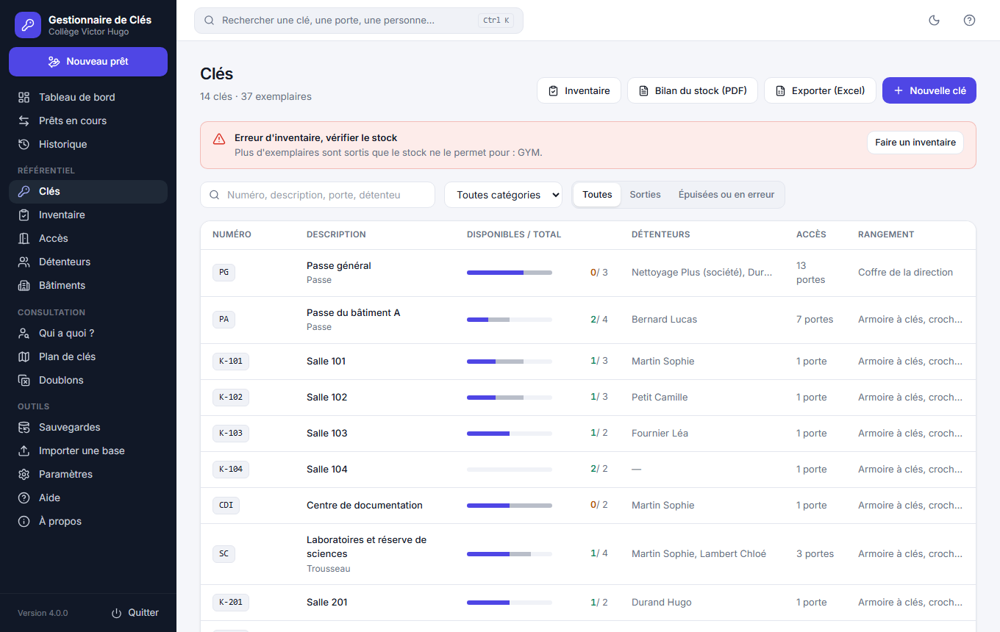<br><sub>Clés et stock</sub></td>
    <td align="center">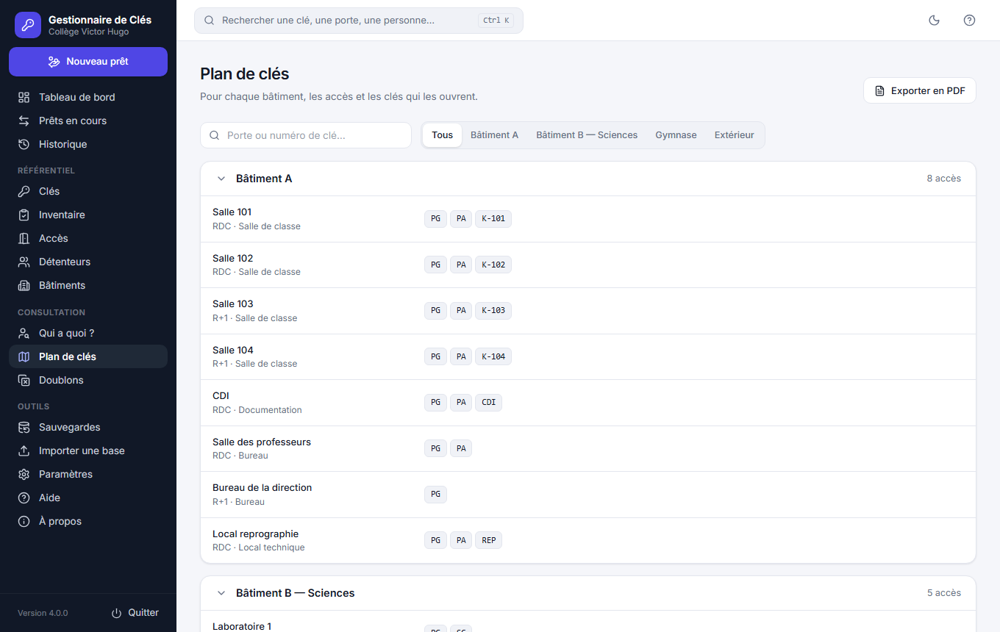<br><sub>Plan de clés</sub></td>
  </tr>
  <tr>
    <td align="center">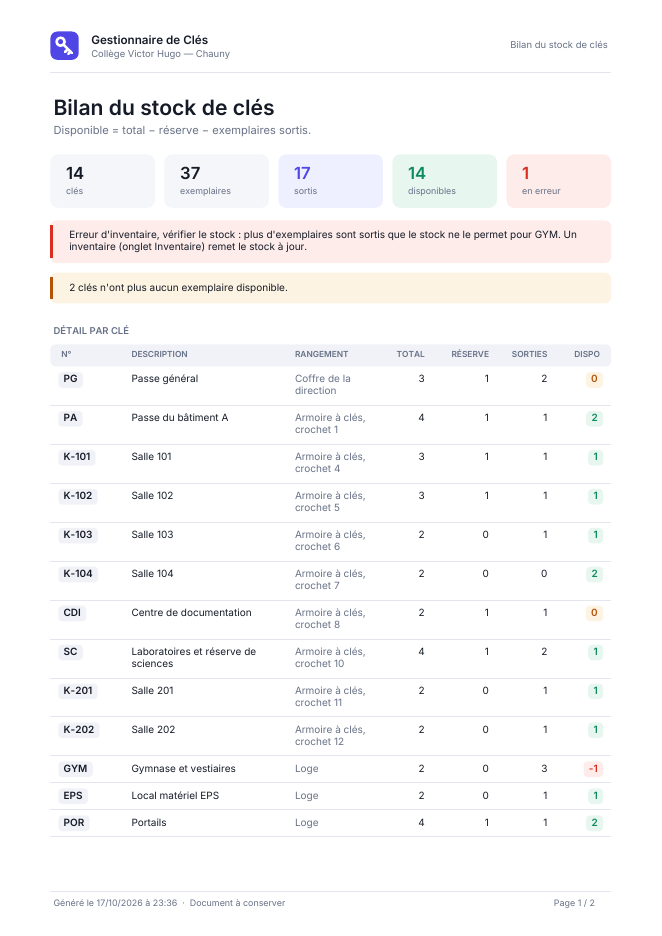<br><sub>Bilan du stock (PDF)</sub></td>
    <td align="center">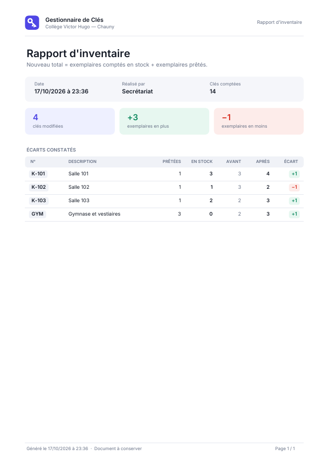<br><sub>Rapport d'inventaire (PDF)</sub></td>
  </tr>
</table>

<p align="center">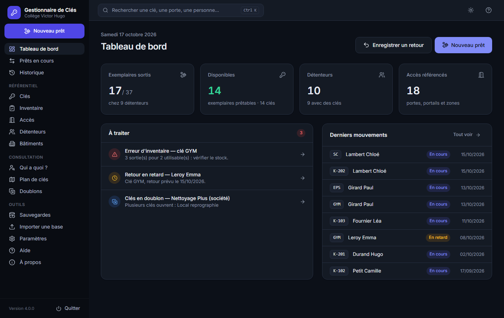<br><sub>Mode sombre</sub></p>

---

## 🔄 Passer d'une ancienne version à la V4

1. Fermez l'ancienne application **sur tous les postes**.
2. Installez la V4 dans un **nouveau dossier** (ne remplacez pas l'ancien).
3. Au premier lancement, importez le `clefs.db` de l'ancien dossier avec l'assistant.
4. Vérifiez le tableau de bord, puis faites une première sauvegarde.

Gardez l'ancien dossier jusqu'à ce que tout soit vérifié : il n'est jamais modifié.

Pour passer ensuite d'une V4 à une V4 plus récente : sauvegarde, fermeture sur tous les postes, remplacement du `.exe` dans le même dossier.

---

## ❓ Questions fréquentes

**Que signifie « erreur d'inventaire » ?** Plus d'exemplaires sont prêtés que le stock déclaré ne le permet. Le prêt n'est pas bloqué, mais il faut vérifier : un inventaire remet le stock d'aplomb.

**Plusieurs personnes peuvent-elles l'utiliser en même temps ?** Oui : placez le dossier sur un partage réseau. Les paramètres sont communs à tous les postes.

**Où sont mes données ?** Dans `clefs.db`, à côté de l'exécutable. Les sauvegardes sont dans `backups/`, les documents dans `documents/`.

**Faut-il internet ?** Non. Tout fonctionne hors ligne.

**Une aide est-elle intégrée ?** Oui : le menu **Aide** reprend ce guide pas à pas, avec un accès direct à chaque écran.

---

## 🛠 Pour les développeurs

### Stack technique

- **Moteur** : Go 1.25 — SQLite (`modernc.org/sqlite`, pur Go, mode WAL), PDF (`gofpdf`, police Inter embarquée)
- **Fenêtre native** : [Wails](https://wails.io) v2.16 (WebView2)
- **Interface** : Svelte 5, TypeScript, Tailwind CSS 4, icônes Lucide — tout est embarqué, rien n'est chargé depuis internet
- **Tests** : `go test` (données, imports V1/V2/V3, inventaire, PDF, services) et `svelte-check`

### Structure

```
main.go                 Point d'entrée Wails (dossier de travail, base, fenêtre)
internal/app/           Services appelés par l'interface (une méthode Go = une fonction JS)
internal/db/            SQLite : requêtes, migrations, sauvegardes, imports V1/V2/V3, paramètres
internal/business/      Logique métier pure (trousseau minimal, redondances)
internal/pdf/           Documents PDF au modèle de l'application
internal/export/        CSV compatible Excel
internal/natsort/       Tri naturel des numéros de clés
frontend/src/app.css    Thème : couleurs et composants (clair / sombre)
frontend/src/pages/     Un écran par fichier
docs/                   Images du README et outil de captures (docs/captures)
```

### Compiler

Prérequis sur le poste de développement uniquement : Go, Node.js, CLI Wails (`go install github.com/wailsapp/wails/v2/cmd/wails@v2.16.0`).

```powershell
.\build.ps1                # liaisons JS + build\bin\clefs.exe
.\build.ps1 -Test          # avec les tests Go et la vérification de l'interface
.\build.ps1 -Package       # + archive de distribution build\release\clefs-windows-amd64.zip
.\build.ps1 -Run           # lance l'application après compilation
```

Avec `make` : `make dev` (rechargement à chaud), `make build`, `make test`, `make check`, `make lint`.

Captures du README : `.\docs\captures\capture.ps1` (données fictives, aucune fenêtre ouverte).

Publication : un tag `v*` déclenche [la CI](.github/workflows/release.yml) (tests, build Windows x64, release GitHub) ; `create-release.sh` vérifie que le tag correspond à la version du code.

La notice technique complète est dans [NOTICE.md](NOTICE.md) ; l'historique des versions dans [CHANGELOG.md](CHANGELOG.md).

---

## 📄 Licence

Distribué sous licence **MIT**. Police Inter : SIL Open Font License (`internal/pdf/fonts/OFL.txt`).

Conçu par **COLLET David** — Secrétaire Général, Collège Victor Hugo, Chauny (02300). Code réalisé par IA (Claude, Anthropic) sous sa direction.
